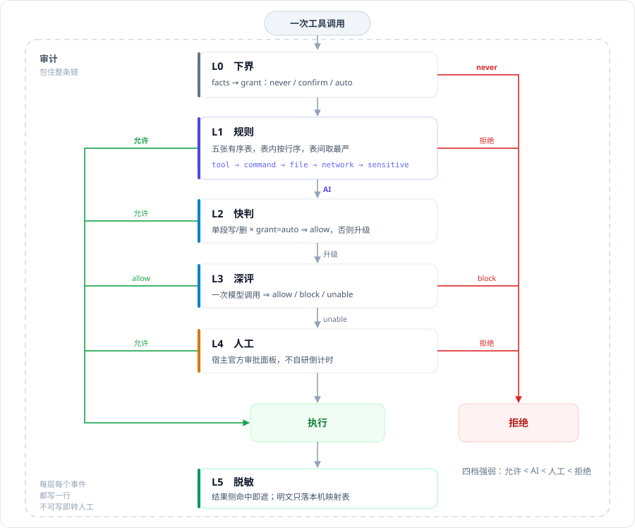

# dsh-auto-approval-frame

[English summary](#english) · 中文完整说明（默认）

DeepSeek Harness 的审批与审计插件。每次工具调用，它替你先看一眼：能按你的规则放行的直接放行，需要判断的交给模型，模型也说不准的再问你。每次判定都记进同一本可校验的台账。

「不用模型费直接放行」不是代码里的特权，它就是你规则表里的一行：能停用、能换档、能调序，台账里说得出是哪一行放的。

## 目录

[五分钟上手](#五分钟上手) · [安装](#安装) · [权限档](#权限档) · [拦截梯](#拦截梯) · [配置](#配置) · [审计库](#审计库) · [它到底看什么](#它到底看什么隐私边界) · [边界](#边界这个插件保证什么不保证什么) · [秘密回填](#秘密回填占位符怎么换回原值) · [AI 审查怎么判](#ai-审查怎么判) · [明确不做](#明确不做) · [English](#english) · [开发说明](#开发说明)

## 五分钟上手

装完到能干活，四步。后面是使用说明，装完能跑就可以跳过，出问题再回来查。

**一、装。** 插件市场搜包名 `dsh-auto-approval-frame`，装完重启 DSH；或命令行 `dsh plugin --profile <你的 profile> add dsh-auto-approval-frame`。细节见下一节。**建议同时装 `dsh-gitbash-shell`**——本插件的解析和测试是按 Git Bash 打磨的，原生命令这条路验证得少，见「安装」。

**二、开。** 设置 → 插件 → 找到 `dsh-auto-approval-frame`，确认开关是开的。再回到会话，打开权限菜单选「自动审批」这一档——没选这一档，插件不接管你的任何会话，既不拦也不记。

**三、写第一条规则。** 设置页的命令表加一行：`git status`，档位选「允许」。之后在会话里让它看 git 状态，这次调用既不弹窗也不花模型费，台账里写得出是这一行放的。想管住一族命令就写 `git`；写得更具体的那行优先，`git push` 压 `git`。

**四、看。** 每次拦截、每次人工答复都在设置页的「审计中心」：时间、动作、落在哪一层（规则／快判／深评／人工）、你当时答了什么。想先问「这条命令会被怎么判」，用设置页的「模拟审批」贴进去，它走的是和真判定同一条链，不会对同一件事说两套话。

## 安装

### 本插件 `dsh-auto-approval-frame`

插件市场搜包名 `dsh-auto-approval-frame`，或：

```sh
dsh plugin --profile <你的 profile> add dsh-auto-approval-frame
```

装完重启 DSH。另外还要做两件事——确认插件是启用状态、在会话权限菜单里选「自动审批」档，见上一节第二步。

### 建议同时装 `dsh-gitbash-shell`

本插件对命令、文件和路径的解析，以及测试，都以 **Git Bash（POSIX）语法**为主路径。`dsh-gitbash-shell` 让 agent 在 Windows 上直接用 Git Bash 执行命令，是与本插件配合最完整的组合。插件市场搜 `dsh-gitbash-shell`，或：

```sh
dsh plugin --profile <你的 profile> add dsh-gitbash-shell
```

装完重启 DSH。

说直白一点：原生 PowerShell／cmd 也在支持范围内（命令表里有专门的原生命令行），但那条路的真实样本少得多，很多写法还没在真机会话里跑过。**没暴露不等于没问题**——用原生命令时，遇到解析没覆盖的写法、判定偏离预期的概率会更高。两套都能用，但 Git Bash 这条路的修复密度、回归覆盖和稳定性都更好；**能装就装**。

## 权限档

插件只接管你在 `gatedPresets` 里勾选的权限档，默认是「自动审批」（`auto-approval`）。这个档由插件自带，装完就能在权限菜单选到。

- 如果你的 profile 自己定义了 `permission` 表，它会整行覆盖插件自带的表。这时保留你已有的档，把 `auto-approval` 加进去；或者直接在设置页的「受管权限档」里勾选你已有的档。
- 受管档不存在时，设置页会红字报出名字，并给出可复制的 profile 片段；在它修好之前，插件不接管任何会话。
- 前提：宿主审批策略必须是 `ask`。如果设了 `DSH_PERMISSION_MODE=danger-full-access`，宿主会被钉成 `never`，没有审批请求，插件也不接管。

## 拦截梯

一次工具调用从上往下走。会给出结论的只有中间四格 **L1 规则 → L2 快判 → L3 深评 → L4 人工**：谁先给出结论，就按它办——放行就执行这次调用；拒绝就只拦这一次、不执行，会话照常；说不准就交给下一格。四格都没说住，才落到人工。



**L0 和 L5 不是关卡。** L0（备料）只把命令拆开、看清要动哪些文件和网络，自己不下结论。L5 只做一件事：跑完命令，命令正常输出的敏感信息换成占位符后，再进入上下文。图上这两格的边框是虚的，就是提醒你它们不参与判定。

**梯子外面还有两件事。** 一是读别的项目根（同层或向上有 `AGENTS.md`／`.git`）而你的话里没点名它——直接问人，模型判放行也不放；你提到的名字能唯一解析到某个目录时，它就把那个目录记成这次会话的根，根内的读直接放行。二是日志审计：它不在梯子上，而是包住整条梯——每一格、每次人工答复、每次配置变更，都写进同一本可校验的库。

每格判什么、能给出哪几种结论，见设置页「模拟审批」的逐步显示；它和真判定走同一条链，不会对同一件事说两套话。

## 配置

一般不用动，默认值就能用。要改，优先在设置页改；下表是全部键，直接改 profile 时用。

| 键 | 默认 | 含义 |
|---|---|---|
| `enabled` | true | 总开关。关掉只停判定（拦／问／放），结果脱敏和台账照常。 |
| `mode` | `auto` | `off` 全交宿主面板／`advise` AI 只给建议／`auto` AI 可放行。 |
| `gatedPresets` | `['auto-approval']` | 接管的权限档，默认「自动审批」；设置页只列它和你的自定义档。 |
| `reviewerSource` | `session` | `session` 跟随当前会话的模型／`preset` 指定模型。 |
| `reviewerProvider` `reviewerModel` | `''` | `preset` 时填。 |
| `reviewerMaxTokens` | 2048 | 深评输出上限；别低于 512，容易截断。 |
| `reviewerTimeoutMs` | 20000 | 深评超时，默认 20 秒，不重试。 |
| `evidenceBudget` | 16000 | 给模型看的证据总字数上限；超了从低优先级裁。 |
| `reviewRules` | `[]` | 你附加给模型的审查规则，只能收窄，不能放宽。 |
| `commandRules` `networkRules` `toolRules` | `[]` | 每行 `{action, match}`；动作四档 `release`／`ai`／`ask`／`deny`，从上往下第一条命中即停。 |
| `fileRules` | `[]` | 每行 `{match, read, write, delete}`；读／写／删三列各选四档或留空（留空＝这行不管这个操作）。 |
| `sensitiveRules` | `[]` | 敏感信息检测规则；预设 10 行，可改正则／档位／停用；命中取最严，不看顺序。 |
| `sensitiveDetect` | true | 检测与脱敏总开关；关掉＝工具结果原样进模型。 |
| `autoRestoreSecrets` | true | 写文件后把占位符换回原值；默认开，但要有回写证。 |
| `fastJudge` | true | 单段写／删先让快判模型判一句。 |
| `fastJudgeMaxTokens` | 256 | 快判输出上限。 |
| `fastJudgeTimeoutMs` | 3000 | 快判超时，默认 3 秒；超时转深评。 |
| `retentionDays` | 90 | 台账保留天数。 |
| `maxTotalBytes` | 512MB | 台账总大小上限。 |
| `maxSegmentBytes` | 50MB | 单个台账文件上限。 |
| `debug` ⓟ | false | 补丁专属，设置页只读。 |

ⓟ = 补丁专属。

### 规则怎么写

- **命令**：写「程序名 + 参数前缀」。`git push` 管住 `git push origin main`，不管 `git pull`；`*` 匹配一个参数；整行只写 `*` 就是所有命令；`re:` 开头按正则。
- **文件**：写路径。`~` 是家目录；`*` 只匹配当前一层，`**` 匹配任意层；路径以 `/` 结尾表示这个目录及其内容。读／写／删三列分别表态，留空＝这行不管这个操作，后面的行仍可管。
- **网络**：写主机名或 IP，如 `api.example.com`、`*.example.com`、`*`；不写端口和路径。
- **工具**：写工具名通配，如 `mcp:*`。
- 旧的三键 `trustedDirs`／`dshOpen`／`neverAutoExtra` 会在启动时自动迁成文件行，之后不再是配置键。

### 规则谁先说话

- 所有行——预设行（插件自带）和你的行——在同一张表里，从上往下，第一条给出结论的行算数。档位就是允许／AI／人工／拒绝四档。
- 预设行不再永远压你一头：把你的允许行放在它上面，就能放开它；拖回去就恢复保守。
- 「拒绝」行只要命中就拒，跟先后无关。
- 「AI」行命中就交模型判一次，后面的行不再看。
- 想改某条预设：能直接改那条行；也可以在你的表里用更具体的行盖住它。

**升级提示：** 旧版的 AI 行是「本层不拦、继续往下走」，现在改成「交模型判一次，后面的行不再看」。插件不会自动改你的行，只在设置页提示一次；有 AI 行的配置请自己确认一遍。

### 允许行意味着什么

- 允许是真放行：不调模型、不弹面板，但会写一条台账；写不进去就转人工。
- 允许行也是信任声明：命中的路径不再算「工作区外」，删除也不再按「内容不可恢复」处理；`~/.dsh` 的子树也可以被开口。整棵 `~/.dsh` 和含凭据的子树仍会被拒绝开口。
- 敏感面的允许只放这一次调用，结果该遮还是遮。
- 盘根和家目录没有特殊开关：它们就是普通目录。`rm -rf C:\`、`rm -rf ~` 都会落「删除·工作区外，问你」；要更严就写一条普通路径行，盘根写成 `C:\`。
- 预设表具体有多少行，以设置页显示为准。

### 默认档会把什么交给模型

- 改工作区根、改到信任区外、改符号链接目标：先交 AI 判。
- 改 `~/.dsh` 的档位配置、台账、审批记录：仍然问你。
- 客户端产物目录的读：不再无条件放行。

### 配置写坏了会怎样

- 保存时只要有一行档位非法、正则编译不过，或行里缺 `match`／`preset`，整次保存被拒，盘上配置原样不动。
- 读进来时如果有坏行，整份配置按「损坏」处理：继续用你上一份合法配置，不退回默认档。
- 设置页会明确提示「当前生效的是上一份合法配置」，并指出坏在哪几行；坏行不会被悄悄丢掉。
- 留空是合法的：留空＝这行不管这个操作，不会被默认值填回。

## 审计库

台账在 `~/.dsh/auto-approval-frame/audit/`，按天分文件，一行一条 JSON，带哈希链，能校验有没有被改过。

- `state.json`：当前写到哪个文件、链尾在哪。
- `manifest.jsonl`：每次分段关闭、裁剪、清空都记一笔。
- `2026-10-27.jsonl`：当天的记录；同一天写满一个段，就接 `.1.jsonl`。
- `legacy/`：旧版单文件台账，升级时原样移进来。

每条记录有时间、类别、事件、结论、落在哪一层，加上这次事件的字段（命令预览、命中的规则、原因、耗时等）。设置页的「审计中心」读的是同一份库，不另存副本；可以查询、导出、清空。默认隐藏启动和配置变更两类簿记，人工答复默认显示；隐藏只影响列表和导出，记录照常入账。

台账默认留 90 天、最多 512MB；到点整段裁掉，裁剪记录留在 `manifest.jsonl`，链仍能校验。旧版的 `decisions.jsonl` 会在启动时自动迁移，原文件移到 `legacy/`。

## 它到底看什么（隐私边界）

**先说要紧的：** 开启审查后，这次调用的命令、目标路径、元数据和最近的用户意图，会走宿主的 LLM 通道发给你配置的模型服务。不能让这些内容出机器，就把 `mode` 设成 `off`，或不要把 `auto-approval` 档接给远端模型。

判定时，插件自己不打开文件读内容，也不会主动去找密码；只有密码出现在这次调用的命令或输出里时，才会在台账预览或结果侧被遮住。它看的是这次调用本身：

- **命令和入参**：要动哪些文件、哪些网络、用什么程序。台账里的命令预览会先遮敏感信息、再截到 400 字；本机绝对路径会原样记下来，台账按敏感件对待。
- **目标的元数据**：存在不存在、是文件还是目录、多大。只查这些，不读正文。
- **工作区里的三条只读 git 信息**：仓库根、跟踪文件、工作区状态。
- **工具执行后的结果文本**：要扫一遍敏感信息、遮完再交给模型；扫描本身会读这段文本。

它存什么：

- **台账**：每次判定一行，含命令预览、路径、结论、时间。默认留 90 天、最多 512MB，到点整段裁掉。
- **敏感值映射表**：结果里被遮掉的值，只在本机 `~/.dsh/auto-approval-frame/secrets.json`，最多 200 条，用来把占位符换回去；不发给模型，也不随台账导出。
- **不存**：文件内容、工具结果全文。

它不联网：除了上面那次宿主 LLM 调用，插件本身不向外部发请求；设置页的诊断接口只回环。

## 边界：这个插件保证什么、不保证什么

这一节是装机前必读。把「它不拦」读成「系统安全」会出事。

1. **「允许」只是本插件不拦，不等于宿主一定执行。** 本插件放行后，宿主自己的策略和 guard 还可能再问一次或直接拒；台账里两格结论不一致是正常的，记的就是谁说了什么。
2. **它在应用层，不是 OS 隔离。** `auto-approval` 这个档本身就是 `danger-full-access` + `approval: ask`，在它下面命令照样能读写你整个用户目录。插件只能「在它发生之前问你」；宿主把档钉成 `never` 的会话它不接管，也就拦不住。要真隔离请用沙箱／容器／只读挂载。
3. **遮掉的明文靠占位符，已经出去的值收不回来。** 命令进台账前遮的是副本，工具结果回给模型前换成 `[[SEC-…]]`；已经到模型手里的原文、命令参数里的 token（宿主不允许插件改参数）都换不回来。值一旦以明文进了一条命令，就按已经泄露处理。
4. **二进制和超长内容不扫，台账会如实写「未扫」。** 太大的块不进入检测面，`unscanned` 计数会记下来。「链能校验」不等于「内容都看过」。
5. **敏感判据靠文件名和形状，改名就绕得过。** 把 `id_rsa` 改名成 `key.txt`，名字那一档就不再命中。它接得住常见泄露形态，不是内容分类器。
6. **你自己加的允许行会盖住预设行。** 表和顺序都是给你改的；把允许行拖到「凭据目录」那一行上面，那条下界对这台机器就失效。这是设计，也是你要自己承担的部分。
7. **宿主不告诉插件「哪些文件真的写成了」。** 自动回写只能按插件自己的写目标推断，再读回文件核对版本；后台命令成功、脚本最后一行成功，都不等于每个中间目标写成。要更硬的保证，需要宿主在执行侧报告写入集合。
8. **总开关只关判定，不关遮罩。** `enabled: false` 或 `mode: off` 停掉的是「拦／问／放」；结果脱敏和台账照常跑。要「结果原样进模型」，得卸载插件，不是关开关。
9. **「用户批准」只认你自己打的字。** 工具问答回传的 `answers` 是结果，不是批准（远端工具可以伪造）；宿主的「计划批准」目前也不算数。插件没有能力验证「这是不是一次真正的用户决定」，所以只认用户原话。
10. **自动回写只能绑到「哪一次调用」，绑不到「执行器确认哪些目标真的落地」。** 和第 7 条是同一个缺口：插件能核对「这次调用确实写了这个文件」靠读回文件版本，但宿主不报告实际写入集合，所以不假装补上了。
11. **插件遮的是副本，宿主最终组包仍是原件。** 结果脱敏改的是交给宿主的那份结果副本；宿主最后组装时还有自己的环节可以往结果里加内容，那部分插件看不见、拦不住，只能在结果侧发现凭据形状时记一笔。要封死最后一道口，需要宿主在执行器层提供最终投影点。

## 秘密回填：占位符怎么换回原值

结果里的敏感值被遮成 `[[SEC-…]]` 后，模型写文件时写进去的就是这个占位符。

**写之前问你一次**

- 文件还没落盘、这次要写进去的内容已经在手里的时候，插件发现里面有本表铸出的占位符，就问一句「要写入『文件名』的内容里有几枚密码占位符，还原吗」，两个选项：还原成真值、保持占位符。
- 选还原：插件当场为「这一次调用＋这个文件」签一张证，写入照常执行，落盘那一刻把占位符换成原值。会话、目的路径、期限都由插件自己填，你不用输入任何东西。
- 选保持，或者没人应答：文件里就是占位符，跟以前一样。
- 只处理文件层；命令参数里的占位符换不了（不允许插件改参数）。`edit` 的 `old_string` 比的是磁盘明文，带占位符会 not found，改被遮的行用按行／模式脚本。
- 关掉设置页的「写之前问要不要还原占位符」，就完全不问、也不回填。

**凭什么说安全**

- **有证才换**：证绑的是「会话＋这次调用＋这个文件＋用途」，四样对上才换，对不上就不换，文件保留占位符，台账记一条「跳过回写」。
- **一张证只用一次**：两个实例同时抢同一张证，只有一个能换成。
- **删了就是删了**：删除和清空会留一条删除标记，旧实例不会把删掉的明文再带回来。
- **换的时候要么整个换成功、要么不动**；跳过凭据树、系统树、符号链接、超过 4MB 和读不出的文件。

**你会看到什么**

- 审计中心会记「写前签了 N 张回填授权」「已回写」或「跳过回写」。

**它不保证什么**

- 只按「插件认为这次调用写了这个文件」回写；宿主不告诉插件执行器实际写了哪些文件，所以后台命令、脚本中间目标有没有落地，插件只能按写目标和读回版本推断（见边界第 7 条）。

## AI 审查怎么判

放行不等于「模型没看出风险」。模型要放行，得逐项回答三个问题：

- **这次动作有必要吗**（necessary）
- **用户的话覆盖到这次动作了吗**（authorized）
- **保障够吗**（safeguarded）

三问里任何一问答「否」，就算模型写了 allow 也不成立，直接改成拒绝，理由分别记成「没必要」「授权没覆盖」「保障不够」。

几条配套规则：

- **证据不完整就不自动放行。** 证据被裁过（不是完整证据），即使模型说 allow，也转人工，台账记下丢了哪一段。
- **没给的部分是未知，不是无害。** 被裁的正文会附「原文多长、留了多少、丢了多长、首尾各一段」；模型判断依赖没看到的部分时，必须说「判不了」，不许猜。
- **区外不再自动等于未授权。** 目标在工作区或已允许目录之外，只说明「范围要算」，不等于「用户没授权」；模型按证据里的原话、目标资源、排除项与撤销记录算覆盖，引文必须逐字出现在证据里。
- **授权读数不再替用户概括。** 「目的」「允许的附属操作」两格已撤（A18）：它们由词表从原话里取词（「全加上」抽不出写、句尾「你看」抽出读），概括只往窄里错，模型又会把它当成授权边界，于是明确授权被判成未授权。防编授权靠引文核验，不靠程序先概括一遍。
- **一次判定优先。** 证据不完整不跑快判；快判放行就结束，只付一次；快判不过才升级深评。

旧模型没给三问的答案时，插件不会额外拒，台账照记；要收紧成「缺三问也不算批准」，需要新增一档配置，本版没做。

## 明确不做

不做自研倒计时（人工档直接用宿主面板）、斜杠命令、学习/熔断、快判的专门分类器、产物溯源。每次需要判断的调用都会付一次快判或深评——这是为了只保留一套判定权。

宿主不允许插件改写工具参数，所以：对工具输出只做**拒绝／允许**两问，脱敏只在结果侧发生；模型把 token 写进文件后的修正只在**文件层**做（可关，默认开但要有证），命令参数里的 token 换不了。

## English

An interception and audit frame for DeepSeek Harness. It manages one permission tier (`auto-approval` by default): every tool call walks preset protections, the ordered rule table, a read-only fact gate, AI fast/deep review, human approval, and result redaction. Every event is written to a hash-chained, day-segmented audit store.

### Quick start

Four steps from install to a working frame; everything after this is reference.

- **Install.** Plugin market → `dsh-auto-approval-frame`, then restart DSH; or `dsh plugin --profile <profile> add dsh-auto-approval-frame`. **Also install `dsh-gitbash-shell`**: the parsers and regression suite are built around the Git Bash path. Native PowerShell/cmd is supported, but it has seen far less real-world coverage, so undiscovered edge cases are more likely there.
- **Enable.** Settings → Plugins → `dsh-auto-approval-frame`, confirm it is on; then open a session's permission menu and choose **Auto approval**. Without that tier the frame manages nothing — it neither blocks nor records.
- **First rule.** On the settings page's command table add a row `git status` with tier **allow**. It then runs with no prompt and no model call, and the audit line names that row. A row for `git` covers the family; the more specific row wins.
- **Audit.** Every block and every human answer is in the audit centre — time, action, layer (rule / fast review / deep review / human), and what you answered. **Simulate** runs the same chain as a real decision.

### Managed permission tiers

The bundle patch ships `auto-approval` (`danger-full-access` sandbox + `approval: ask`). A profile-level `permission` row overrides the whole table; if you own one, add `auto-approval` there or select an existing custom tier in the page.

The page lists only `auto-approval` plus custom tiers. Read-only / workspace-write / danger-full-access are not listed: read-only has nothing to release, workspace-write's grant is `confirm` (AI cannot release), and danger-full-access pins approval to `never` (no prompt). A saved legacy choice stays visible so you can switch it off. When a managed tier is missing, the page reports it with a copyable profile snippet.

### What it writes

- `~/.dsh/auto-approval-frame/audit/`: hash-chained day segments, manifest, state, legacy imports.
- `~/.dsh/auto-approval-frame/`: the local reversible token vault (secrets are masked before they reach the model).

### Language

The settings page follows the host locale (`<html lang>`): Chinese clients get Chinese, English clients get English. README Chinese is the full reference; this section is the English summary. Audit messages are stored as generated.

### Tests

```bash
node test/frame.test.mjs && node test/effects.test.mjs && node test/wiring.test.mjs && node test/client.test.mjs
```

Not affiliated with DeepSeek.

## 开发说明

这一节是实现契约与回归锁；只使用插件可以跳过。

<details>
<summary>展开：配置版本语义 · 实现备注 · AI 审查实现 · 效果分类 · 设置页细节 · 24 条不变量</summary>

### 配置的版本语义

- `configVersion` 带语义纪元前缀 `2:<12hex>`；旧语义下发出的批准不会命中新语义。
- 同一份配置在纪元变化前后拿到不同的版本串；读到比自己更新的纪元时，保留上一份合法配置、页面只读提示，不清空你的规则。
- 同一次判定里，`frame` 接口、审计判定行、证据块的 `configVersion` 是同一个串（回归锁 `test/config-evidence.test.mjs`）。
- 预设表行数：文件 63、命令 318、工具 3、检测 10；快照锁 `test/_preset-snapshot.mjs`。
- 配置损坏：保存被拒记 `configDamage.reason = 'save-rejected'`；读入坏配置（`rules-invalid`／`unparsable`）时继续用上一份合法配置；`configDamage` 非空就是页面上的「当前生效的是上一份合法配置」。

### 实现备注

- **判定链只有一份实现**：`lib/frame/ladder.js` 的 `walkLadder()`。真判定与设置页「模拟审批」都调它，步骤文案由 `ladderSteps()`／`ladderVerdict()` 从同一次 walk 派生；`test/wiring.test.mjs` 有差分锁，逐条比对模拟落点与台账第一条定局行。
- **层名两份表**：`audit.js` 的 `LAYER_TEXT`（node 侧）和 `client.js` 的 `LAYER_LABEL`（webview 侧）必须逐字一致，`test/client.test.mjs` 按字面比对。
- **人工答复的观测点**：读 `session/event` 的 `approval/asked` → `approval/decided`，不读 `approval/request`——后者是宿主跨进程转发的 waterfall，宿主自己的应答器先终结，插件监听排在后面进不去。每次调用按 `callId` + `actionHash` 存一条 pending，这一侧只读它，不重新推导（`lib/frame/pending.js`）。
- **审计校验**：`verify()` 校验 manifest 的 sha256／条数／链尾、逐行 hash、prevHash、sequence 连续性；分段被保留策略裁掉后，靠墓碑继续校验。旧 `decisions.jsonl` 在启动时迁移，并记 `lifecycle.migrate` 与旧文件 sha256。

### AI 审查实现

- 三问在 `lib/frame/verdict.js` 的 `REVIEW_QUESTIONS`；`parseVerdict()` 把任一假改成 block；`mayRelease()` 在 `mode=auto ∧ grant.state=auto ∧ reviewed/allow` 之后再判一次。
- 证据裁剪由 `lib/frame/evidence.js` 的 `projectEvidence()` 记 `{field, kept, lost}`；`completeness` 只有 `full`／`partial`／`too-large`；`lib/index.js` 的 `evidenceComplete` 只认 `full`。
- 读数在 `test/evidence.test.mjs`；把 `clip()` 的记账关掉，或把三问退回只认 `no_material_risk`，对应用例转红。

### 效果分类：一条命令被拆成哪些角色

事实层（`lib/frame/parse.js`／`facts.js`）把一次调用拆成**作用项**，每项带一个角色；档位不在这里定，
这里只说「实际会发生什么」。角色一共十种，台账与证据块都按它显示：

| 角色 | 含义 | 例子 |
|---|---|---|
| `executable` | 被执行的那个程序本体（带路径时才记） | `/usr/bin/python3 -V` |
| `script-read` | 解释器读进来执行的脚本（**读**，不是写目标） | `python -S sync_docs.py --help` |
| `read-source` | 被读的文件 | `cat a.md`、`cp a.md x` 的源 |
| `stdin` | 输入重定向／here-string 的数据源 | `cat < in.txt` |
| `read-manifest` | 一张「文件清单」本身 | `wc --files0-from=list`、`tar -T list`、`xargs -a list` |
| `write-destination` | 真正的写目的 | `> out`、`sort -o out`、`cp a.md dir/` 的 `dir/a.md` |
| `directory-container` | 当作容器读的目录 | `grep -r x .`、`ls dir` |
| `delete` | 删除目标 | `rm -f a.md` |
| `network-source` / `network-destination` | 网络面的「取回」／「送出·远端执行」 | `curl URL`／`scp a.txt host:/` |

四条容易算错的形状，现在按真实效果记：

1. **解释器 + 脚本**：`python -S …/sync_docs.py --help` 的脚本是 `script-read`。旧形按「像路径」把它当写目标，
   于是整条只读命令落进写档、理由还指向 `~/.dsh`。
2. **输入重定向**：`cat < in.txt` 的 `<` 是 `stdin`（读），不把整段变成写；`>`／`>>`／`2>` 仍是写目的。
3. **cp／mv 到已存在的目录**：真正被写的是「目录 + 源文件名」（`cp a.md .` ⇒ `<ws>/a.md`），
   容器目录单列在 `container`，不会再让 `.` 本身命中「工作区根本体」。反向：`rm -rf <ws>` 仍是根级下界。
4. **清单旗标**：`--files0-from`／`-T`／`-a` 的取值按 `read-manifest` 读，列出的名字展开成读面；
   `xargs -a list rm` 的内层是删除程序时，展开项仍按 `delete` 记、整段仍走删除档。

**读的举证要看得见全貌**（`completeness`）。递归读（`grep -r`、`rg`、`find`）会把读面枚举进目标集，上限
深度 4／访问 800／条数 20；任一触顶记 `truncated`，读目录或 `lstat` 失败记 `error`，两者都**不许**走
「已证明只读」那行。没有列出任何目标的调用同样不换免检；扫描报错不当「没发现」。
宿主原生读工具（`read`／`grep`／`glob`／`ls`）省略 path 时，读面是宿主默认 cwd，会把这一格展开成
真实作用项，不再出现「作用项空、照样放行」。`sed -n 1p file` 这类纯打印也举得出只读证（脚本只认
行号＋p／d／n，且不带 `-i`／`-e`／`-f`）；换成 `python -c open()` 则仍交模型——差在事实层，
不在路由层。
方言按归一 basename 分档（`Get-ChildItem`／`findstr.exe` 与 `ls`／`grep` 同一套判据），
单引号里的 `*`、`;`、`$` 是字面量，不当通配／分段／展开（未加引号的照旧算）；双引号里的 `$` 仍会展开，整词环境变量按判定这一刻的取值算死（见不变量 16）。
`proven-read` 还要过**任务资源范围**：本项目与已装技能的说明读直放；别的项目的业务／架构／
面板／配置档案即使只读也交模型判必要性（人写的允许行仍可显式开口）。

### 设置页细节

这一节写给要改页面的人；只用默认设置可以跳过。页面在 `lib/client.js`，顶部是一条判定链（0 是否接管 → 1 安全规则（预设行＋你的有序表；命令面一条命令一行＋末行兜底）→ 2 快判 → 3 深评 → 4 人工 → 5 结果脱敏，
标出哪几步可配、哪几步固定，点一格跳到对应卡片），卡片顺序就是执行顺序：**接管与模式**（开关／模式／受管权限档）、
**安全规则**（两级页面：默认四行摘要——命令安全／文件安全／网络安全／工具规则，各带一句说明与条数；点一行进明细，`‹ 返回` 回列表。
明细页自上而下＝表头（图标＋标题＋条数）→ 一条工具行（条件输入框／新规则默认动作／＋ 添加）→ 一条说明 → 一张表（用户行与预设行同一个列表，行首「用户／预设」片区分，都可改、都能调序）、
**AI 审查**（模型／快判／自定义审查规则，超时与预算收进「高级」）、**敏感保护**（一张卡两行并列：**检测规则** 走同样两级——摘要行→明细表；**敏感信息** 记着遮出来的占位符，可看明文／开关回写／清空；总闸 `启用检测与脱敏` 画在卡头右侧，
不占一行——`启用本插件` 同形制）、
**审计中心**（保留策略在「高级」，加查询／导出／清空）。一张卡只有一个容器（`.dsa-card`），卡内一律 `.dsa-item` 一种行（字段行／摘要行／规则行／审计条目同形制）。分层靠三档边框＋有色行底：卡框 `border-l3` → 行框 `l2` → 控件 `l1`，行底用自定一档 `--dsa-row`（浅色＝黑 2.2%／深色＝白 4.5%，按宿主主题选择器 `body[data-ds-dark-theme]` 各给一档，只比卡底深一点点）——宿主的 `bg-layer-1/2/3` 在浅色主题下**全是 `#fff`**，靠它拉层级无效，而 `bg-module-platform` 又太深；也不许用投影，分层要有梯度而不是靠影子糊。规则行分两层：上层是编号｜来源片（用户／预设）｜主语与条件｜行操作（拖动把手／启停／删除），下层是读／写／删的动作片（片内＝操作图标＋操作名＋彩色圆点＋档位）——动作片靠右、略小，五张表同一把尺。行首编号只是序号，敏感面命中取最严、不看先后；每行都有启用开关；删除按钮对用户行直接删、对预设行写 `removed` 标记（不显示、不再拉高）。文件／网络／工具面的预设行**条件列是说明文字**（命中由事实层给，改了字也改不了命中范围）；命令面的条件列就是**命令名**（一条命令一行，算法算出的结果只许把档位加严），末行「其他命令」固定末位、没有删除入口与拖动把手；敏感面的条件列才是可改的正则；文件面的预设行与用户行同形制：读／写／删三颗档位片各自表态（只放行 `~/.ssh` 的读、`~/.aws` 仍必人工，就是这个粒度才做得到）；路径说明可换行显示全。动作片统一带一枚动作色点（行内与工具条「新规则默认」同一套片子，四档只靠彩点区分：拒绝红／人工黄／AI 靛蓝／允许绿（片子白底，不再整片染色）；不带操作名的单动作片统一最小宽度，AI 不会比「人工」窄一截），**不嵌原生 `<select>`**（系统弹出层比片子窄一圈、字也更小，点开就风格断档），也不是摊在行里的一排按钮：点片子弹出一个**贴在片子正下方的浮层菜单**（宽度不小于片子、l3 边框＋实底、无投影），选项行 30px 高、按动作着色、当前项打勾，点外面或选中即收起，一屏只开一个。文件行的读／写／删三颗片在第二行右对齐；拖动把手排序，拖到预设行之间时会整表物化一次以持久化顺序。保存／撤销：干净态只是页尾一行，**有待保存改动才**升格成粘底悬浮条（`.dsa-footer.is-dirty`），按钮靠右＝说明在左 → 撤销 → 保存最右。
样式集中在 `settingsCss()` 注入的一张 `<style>`：内联 style 给不了
`:hover` 与 `disabled` 两态，而这套页面全靠这两态才看得清；颜色全部走宿主设计令牌，深浅色自动跟随。宿主本来会给没注册自定义页的插件**自动生成一张表单**（`autoGenerate`：
"Generate a page if no custom page is registered for this instance"，见 `@deepseek-ai/dsh-api-remotes`
客户端），那张表直接用 schema 键名当标签 ⇒ 没有客户端半时看到的就是英文键名页。注册自定义页后由本文件接管。
写入只经 `form.mutate([{op:'set',path:[key],value}])`，且只能点名 volatile 字段（＝`EDITABLE_KEYS`）；
`debug` 在卡片上只读，改动走 profile 补丁；`gatedPresets` 在「接管与模式」卡按宿主 live 权限目录勾选。预设保护与生效的信任／开口／被拒行由
`GET /api/auto-approval-frame/frame` 从宿主读回，页面不自己复算。
规则行写成**一句话**：`当 命令 匹配 [git push --force] → [拒绝]`；文件面在同一句里嵌 读／写／删 三颗片（留空＝不表态，后面那行仍可管）。
读序＝语法序，不需要读者去对列，条件还能就地改。页面顶部的**模拟审批**（原名「试算」→「模拟执行」→「模拟审批」，名字都由用户定；按钮「模拟一下」，输入框 460px 一行高；`GET /api/auto-approval-frame/explain`，同源只回环）把一条命令喂给判定链，
逐步回落在哪一关、为什么，决定步之后一律标「不再走」；它不调模型、不执行任何东西，答的是「为什么会这样」而不是「AI 会不会同意」。

**会话侧只做两件事：预设文案与 aria 按界面语言改写、给本档补图标**（在本机跑通的判据：
图标只加在宿主确实给其他档位画图标的面——权限菜单行与输入框触发器；弹层行与设置选择器只改文案；
纯文本列表不塞孤立图标；原文留档以便语言切换还原；每轮清孤儿图标）。

**不劫持宿主点击。** 上一版在这里加了「启用前风险确认」：捕获阶段 preventDefault 拦下对「自动审批」行的
点击，事后再对该节点补发一次 click —— 但宿主菜单一关，节点已脱离文档，补发的点击走不到宿主挂在容器上的
委托监听，结果是**确认了却切不过去**。插件不该假借宿主的交互通道，故这道门整段移除；
高风险档的把关回到预设下界与判定链本身。回归里锁了一条硬判据：点击「自动审批」必须直达宿主。

---

### 不变量（回归锁死）

24 条。每条第一行是判据，下面几行是判据怎么落到代码里。任一条被打破，对应的回归用例会红。

1. `never` 的路径，内容不进模型。

   覆盖五类：凭据树、系统关键树、`.git` 内、DSH_HOME 状态树（未被允许行开口）、工作区根本身。

2. 规则四档只往严的方向叠加。

   `deny` 直接拒，`ask` 问你，`ai` 交模型判一次、后面的行不再表态，`release` 真放行——不调模型、不弹面板。

   任一 `deny` 命中就拒，跟行的先后无关。

   `release` 放行前要留下可追责的账，写不下就不放行（见第 7 条）。

3. ALLOW 只在 `grant=auto × mode=auto` 时有释放力。

   `confirm` 档里，ALLOW 只作为建议随弹窗展示。

4. `allow` 与 `reasonCode=no_material_risk` 必须同时成立。

   两者矛盾时，一律改写成 block。

   快判给出的 block 只表示「升级到深评」，不是终局拒绝。

5. 评审举不出结论时，落点分两档。

   四种成因都算 `unable`：超时、坏 JSON、路由不可用、证据过大。

   证据过大（`context_too_large`）一律回落人工——模型根本没看全，不许静默放行。

   纯读可以放行：面集合全是读、目标集已确定、没有机械下界理由，走「unable 兜底」，台账记 `layer=deep` 与 `unableTier`，指得出是哪一次评审举不出结论。

   其余情况（含任何副作用面）仍回落人工。

6. 你答复之后那一侧，不再调用 L0／L1。

   判定从 `session/event` 只按 `approval/asked` 的 callId 取 pending。

   pending 按 `actionHash` 绑定，动作漂了不继承判决。

7. 账记不下来，就不放行。

   这条约束覆盖四个放行出口：表里的「允许」行、只读与内部工具举证行、快判、深评。

   本插件放行的每一笔都要有账可查；写不进审计库，降级为人工。

8. 纯读能不能免审，由命令面的一行拍板，不靠证据行。

   `proven-read` 已经不是表行：证据仍由事实层举（台账里读得出），但「这条调用能不能免审」只认命令清单里的行。

   出厂命令面的读族行就是「允许」，所以纯读直接放行、不调模型（行数与范围见第 24 条）。

   要收紧，就停用或改档这些行。

   命令表一行都没接住的段，仍落末行「其他命令」交 AI 判。

   只编辑会话的内部工具（`compress`／`decompress`／`acp_status`／`acp_cache`／`todo_write`）走「会话内部工具」那一行。

9. 语气不构成授权证据。

   情绪化的句子降级进「非授权背景块」：内容照录，授权标签摘除。

10. 结果侧命中就遮，与档位无关。

    任何一档（含允许）先换成确定性 token `[[SEC-<12 hex>]]`。

    档位只决定遮完之后怎么办：问你、放行，还是整段不给模型。

    明文只落本机 `secrets.json`（200 条／30 天），列表默认不出明文；查看明文要单独取一次，并入账。

11. 人工答复与工具结果都入账。

    `approval.answer` 记宿主那四个结局：已批准（`allowed-once`）、已拒绝（`rejected`）、没答（`cancelled`）、没有应答通道（`unavailable`），并带上它批的那条动作。

    `tool.result` 记成功或失败，附结果首段。

    所以一条 ask 不会在列表里留下没有结局的悬尾。

12. 自动回写只发生在文件层，且只换本表铸出的 token。

    写完读回、原子重写；跳过凭据树、系统树、符号链接、超 4 MB 与读不出的文件。

    超限、非 UTF-8、读不出内容这三类属「载体装不下占位符」，跳过不记账——否则一次 `cp` 一个编译产物，台账里就留一行像告警的记录。

    凭据树、符号链接、无授权、目标被改，照旧各记一条。

    命令参数里的 token 换不了，宿主契约禁止改写参数。

13. 本机以外的目标，不当作本机路径。

    远端主机单独记一栏，也喂给网络面——写一行 `deny prod.example` 就拦得住 `scp out.txt user@prod.example:/tmp`。

    外传一族各占一行：`git push`／`curl -T`／`aws s3 cp`／`docker push`／`npm publish`／`gh release create`。

    脚本正文也算外传面：内联 `-c`、heredoc、脚本文件里同时出现发送动作和目的主机，记成 `exfil:script-upload`；只连不发的（测延迟、TLS 握手）不算。

    网络表末尾固定一行「其他外传主机」，只管上行方向，默认人工，可改档、可停用，删不掉也挪不走。

    这些事实一律把 grant 压到 `confirm`：模型看不见机器外面发生了什么，无权单独放行，只能问人。

14. 目标提取只认真实操作数——判据是「这条命令要动的东西」，不是「命令行里出现了什么字」。

    词首 `#` 之后是注释。

    `<<`／`<<-`／`<<<` 的标记与 heredoc 正文整体消失：正文是数据，不是命令。

    不像路径的词不折成路径：`--line 10`、`--label 决定·面板`、纯符号。

    以文件为操作对象的程序除外：`rm -f junk` 里没有点也真是文件，这格一丢，删除下界就没了。

    反面例子：正文词 `token` 曾被折成 `…\面板.md\token`、命中凭据名，把一条往受管文档追加表格行的命令降成「模型无权放行」。

    事实层被截断单独成行（`facts-truncated`，默认 `ai`＝送去判），不再冒充「一次动得太多」。

15. 默认档不靠顺序，靠作用面。

    预设行的文件面带 `read`／`write`／`delete` 三列默认值，`''` 表示对该操作不表态，不再一律回落成人工。

    「读类不再逐次问人」是在表上解的，`walkLadder` 的步骤次序一步没动——把只读门前移，会让 `cat ~/.ssh/id_ed25519` 静默放行（实测三条反例）。

    客户端状态族（`~/.dsh`・`~/.workbuddy`・`~/.qoder`・`~/.copilot`）的读豁免只有两条行、四道闸口：目录属于该族、不是 `profiles`／`bin`、整条路径没有任何凭据形状的段、不是目录本体下直接摆的文件。

    `skills`／`docs` 子树的读默认放行，其余子树的读默认交模型判。

    `~/.gnupg/skills` 这类「凭据目录里恰好叫 skills」不放——按目录名放行就是把自己骗过去。

    `.workbuddy`／`.qoder`／`.copilot` 三行按家目录直接子段匹配（`homeOnly`）：客户端还会在每个会话工作区注入一份同名目录，那不是 `~/.workbuddy`，不该拿它当理由文案。

    这三行的读默认交模型判，写与删仍人工。

    `~/.dsh`（`profiles` 是宿主配置）与 `~/.ssh` 的读，不随这次降档。

16. 只读证里「哪个词是路径」，按位判。

    位只在 `positions.js` 一张表里定义：124 只读族程序 × 八位（`read`／`write`／`exec`／`take`／`key`／`pattern`／`nopath`／`nav`），每行带 `evidence`。

    `facts.js` 只查表，段上落一列 `wordRoles`（`flag`／`path`／`nopath`）。

    `write` 位的取值只进写面，不再记一份读。

    `exec` 位的后随程序按同一张表再查，内层是读族则本段仍算读；`{}`／`\;` 是占位符，不是路径。

    表外程序不产读证，目标面保持保守：表外程序与表外旗标的词按 `path`。

    未引用的通配在当前目录有界展开（≤20 个）后名字进目标；判读与程序名无关——展开成功（含 0 命中）就是目标集确定，`head *.md` 与 `cat *.md` 同判。

    引号里的 `*` 是字面字符，0 命中是空集，两者都仍是读（只是目标为空），不铸假目标。

    只有「列不出／触顶／不支持」才按「参数含通配」否证。

    没有路径参数的读（`grep TODO` 读 stdin）仍算「读面为空」，不换已证明只读。

    命令替换（`$(`／反引号）仍扫全部词，不按位置放宽。

    整词 `$名`／`${名}` 只在「读族 + 路径位」、且整条命令没有运行时改名写法时，按判定这一刻的环境值算死。

    运行时改名写法包括 `X=…`、`${X:=…}`、`read X`、`eval`、`source`、`for X in …`、`select X in …`、算术 `((`。

    未设或空值当空串（读、目标为空）；非空值必须是真实存在的路径（只 `lstat`、不读正文）。

    argv 仍留原文，环境变量的值不进证据；目标集按「段＋路径＋动作」去重。

    读再分两面：`name`（只回名字、计数、元数据，正文不进会话）与 `body`（回正文片段，走敏感面严审）。

    `positions.js` 每只程序带 `face`：`grep -l/-L/-c/-q` 切 name，`grep -n/-o` 切 body。

    组合按三类判：`-exec` 与 `xargs` 把内层程序按同一张表再查、内层的面决定本段面；管道各段取最严，且流不洗面（上游只回名字则整条 name，上游读正文则整条 body）；重定向是段与文件绑定，不参与组合。

    facts 产出 `readFace` 一列。

17. `git config` 后面那个点分词是配置键，不是文件。

    判定要两条同时成立：子命令在表里登记过、点分词形状符合。

    形状是 `段.名`，不以点开头的点分词。

    取值位、旗标取值位、表外程序、非 `config` 子命令，一律照旧按 `path`。

    清假目标的边界，是不把真目标一起清掉：`--file <路径>`／`-C <目录>` 的取值照旧进目标集。

    `git config --get user.name` 这类已放行的读，不许因为键位消失而改弹人。

18. 「有没有保障」这一问，只在算法量得出「动不掉任何已有东西」时才代填。

    量得出的只有两件事：`proven-read`（整段已证只读）、`target-absent`（全部目标都是 `write` 面，落点在 `workspace`／`trusted`／`dsh-open` 之一，且 `kind` 全是 `absent`）。

    以下一律不代填：删除、改名、销毁、提权、历史改写、执行、读面掺进来、落点读不出、动态目标。

    「已被 git 跟踪且干净」「有第二份副本」两格还没测得出，也不代填。

    代填只发生在模型已判 allow 那格：它判 block 时，第三问的答否是它拒的一部分，抹掉会把台账里的拒因换掉（实测那一格 `ask`→`blocked`，方向是往严）。

    台账按格署名 `checksBy`（`ai` 或 `algorithm:<事实>`）；`safeguardedBy` 的取值不变，两把锁判据读它。

19. 没有可对证依据的放行，不成立。

    模型要放行，得交出两样机器验得了的东西：`basis.rule` 逐字等于本次证据里某一行的行名，`basis.quote` 逐字出现在它读到的那份证据里。

    引你的原话不设下限——你回「可以」两个字就够当授权；引技术碎片不短于 12 字。

    引用要照展示形态抄：证据是 JSON 文本，自己解开转义就不再逐字相同。

    验不出就落「问人」，不改判成 block——那是模型的话，框架不替它改结论。代价是多问一次人；拿没见过的话作保才是事故。

    老调用方不传 `basis`，维持原判据。

20. 本机以外的破坏族是硬闸行，不是模型的话。

    覆盖云控制面、IaC、集群、库表语句、容器产物、账号、计划任务的销毁动作，共八行（`DESTROY_ROWS`，出厂 `ask`）。

    认法按「程序名＋子命令词／旗标／语句形状」，不按 `opClass` 认——`aws s3 rm`、`terraform destroy` 在事实层没有可 `lstat` 的目标，只看 opClass 会整族漏掉。

    判定链在这一步就把人抬出来，走不到模型（实测这些形状 `review=0`），所以 AI 的 allow 与任何上层代放都碰不到它。

    要放宽，只能由操作者自己改这一行。

    代价：命中靠程序名白名单，白名单外的同类工具（如自研 CLI）不在这一族。

    边界：读类与本机文件面一格未动（实测对照 15 格逐格同）。

21. 人工放行只按「类」沿用，且同类沿用有帽。

    第三把键由五样组成：会话、工具、本次真命中的规则行、面集合（读／写／删）、目标根类别（`classkey.js`）。

    它不跨会话、不跨配置版本，也不活过 TTL。

    以下一律不建键、不回放：删除／改名／销毁／提权／历史改写／执行／未归类工具；`elevated:`／`destroy:`／`exfil:`／`credential-`／`remote-` 任一理由；进程族与装包族；区外目标；跨项目读；动态目标；无目标事实；以及 `unrecoverable-content`／`batch-too-large`／`facts-truncated`／`opaque-command`／`symlink-operand` 等逐条排除项。

    跳过时记下原因（`classOf` 回原因，落进 `approval.answer` 行的 `classReceipt.skip`）。

    同一类键沿用到 `CLASS_REUSE_CAP`（8 次）后，这一格重新问人，弹框写明「已沿用 N 次」和最初批准的时刻——等于重复调用升级。

    每次重新批准把计数归零。

    实测对照：无批准时 17 格与改前逐格同，类键没新增任何放行；批准后只有「区内 git 写子命令」由 `ask`→`allow`，排除格零回放。

22. 目标集为空时，没有退化键。

    `targetDigestOf([])` 对所有无路径命令算出同一个值。

    旧形制下，一次 `allowed-once` 就让 `git push`／`systemctl restart`／`npm install`／`aws ec2 terminate-instances`／`mysql -e "DROP TABLE"` 互相顶替（改前实测 6 格 `ask`→`allow`）。

    现在空摘要不构成退化键，这些命令各问各的。

    宿主给了 `actionHash` 时，按动作键照旧沿用，与目标集空不空无关。

23. AI 层的提示词规则先行。

    顺序是：先列命中的规则行（原文逐字，多行全列、取最严），再给用户原话、卡、证据、硬底线，最后判「这次动作在不在规则允许的范围内」。

    AI 只回 `card + verdict` 一个 JSON。

    `reasonCode` 四个出口：`no_material_risk`（放行）、`not_necessary`（缩范围回执行端）、`authorization_not_covering`（要授权回执行端）、`safeguards_insufficient`（兜不住也回执行端）。

    执行端被拒收到的整串：`AI 自动拒绝（中文码／原码）：评审说：<评审 summary｜narrowerScope>｜建议：向用户要完整路径和动作。` 前缀声明这是程序自动拦的（不是用户在拒）；中段是评审原文——理由码只到「哪一问没通过」，说不出这一条缺什么，所以原文必留；末段只在 `authorization_not_covering` 出现，写死下一步。原文在前、建议在后；建议定长，额度 480 先扣它，截只截原文末尾。不点名路径：`facts.targets`（role 混装，读源与写目的同列）与用户原话里正则抽的资源（只认路径形状）都是推断，推断不准就不写成断言。

    `unable` 只留证据不足，仍问人。

    三问由结论反推：`allow` 对应三真；各 block 把对应那问答 false。

    授权来源只认这一条口径：算法路由到 AI、allow、依据有效、grant auto、算得稳（非不可逆、无动态目标、无运行时展开、非解释器族）。台账记 `safeguardedBy=authorization`／`safeguardFact=user-words+rule-row`。

    任务卡由评审端抽（可做／在哪／不可做／单独授权，每项带用户原话逐字引文，不短于 12 字）。

    插件按会话存，下次带上；引文核不过的项丢弃并计数。卡只收窄，不放宽。

24. 命令面一条命令一行，行上只有四件：`command`／`action`／`enabled`／`note`。

    `verbs`／`flags`／`statements`／`pairs`／`history`／`ops`／`execFamily`／`execDynamic`／`scope` 这些条件与范围字段，一个都不进表。

    算法根据这次调用算出的结果只影响判定，不再冒充表行——原 11 条结果行整类拿掉。

    `proven-read`／`unproven-read`／`interpreter`／`inline`／`piped`／`process`／`package`／`opaque-command` 落末行兜底交 AI。

    来源不可举证的内联与管道、框架解释不了的删除参数，由事实层内部下界保 `ask`，不进表、不可配。

    同一段命中多行时取最长命令名（具体压泛化：`git push` 压 `git`，`docker system prune` 压 `docker`）。

    多段命令各自命中，合成取最严。

    末行「其他命令」固定最后：可改档、可停用，不可删、不可上移。

    前面所有命令一个都没命中时，这次调用交 AI 判，绝不空放。

    出厂命令面有 106 行 `release`，全是读族（`cat`／`ls`／`git status`／`grep`…）。

    它们带到会写的参数时（`sort -o`、`sed -i`），写仍由文件面按落点判，删除由事实层下界问人。

    文件面、工具面、网络面的行与档，一格未动。

</details>
